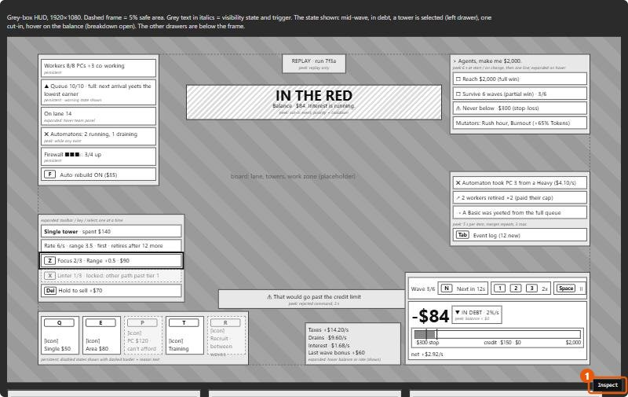
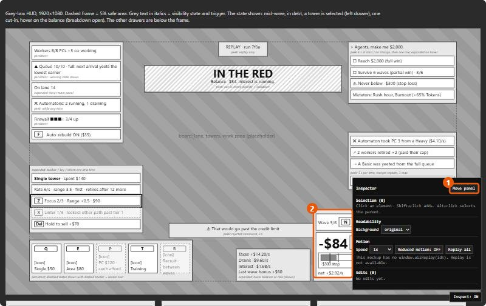
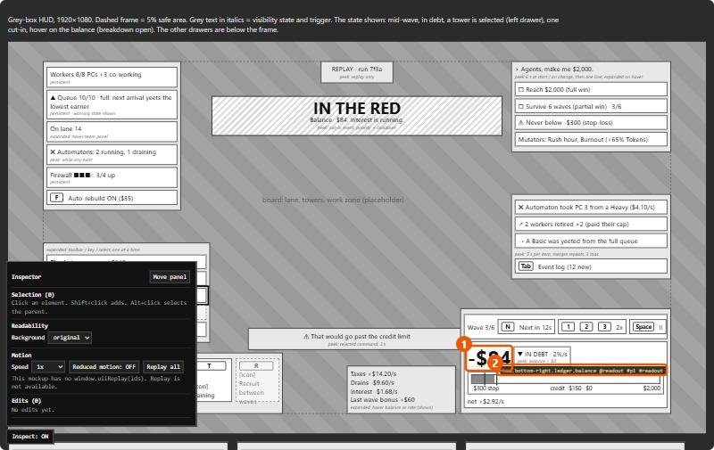
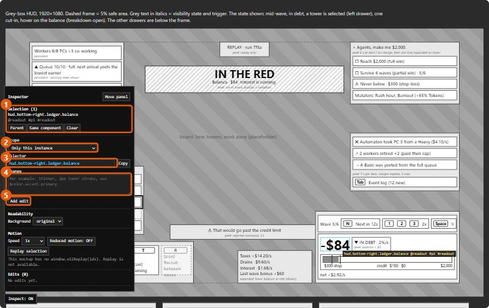
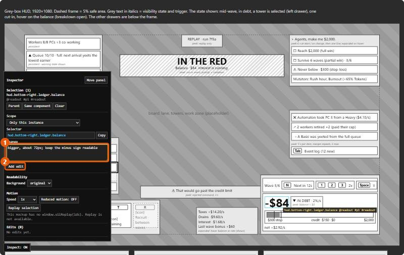
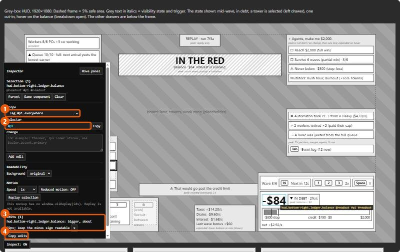
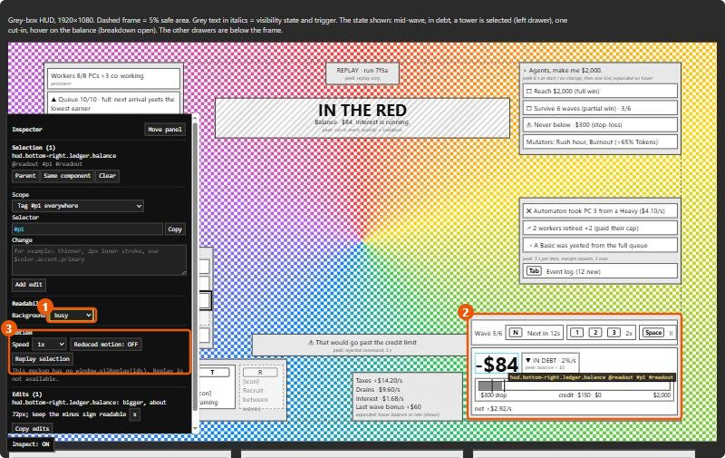

# Inspector walkthrough

How to point at elements in a mockup and send Claude exact edit commands. The screenshots show a grey-box HUD wireframe at 1440×900. The numbers in each image match the numbered notes below it.

## 1. Turn the inspector on



1. Click **Inspect** in the bottom-right corner, or press the backquote key (`` ` ``). If the Japanese IME is on, the key can fail. Then use the button.

## 2. The panel opens. Move it if it covers something



1. **Move panel** sends the panel to the next corner (bottom-right → bottom-left → top-left → top-right). The page remembers the corner.
2. Here the panel covers the money corner, which is the part we want to inspect.

## 3. Hover to read an address



1. The element under the pointer gets a dashed yellow outline.
2. The tooltip shows its address, its component and its tags: `hud.bottom-right.ledger.balance @readout #p1 #readout`. The inspector picks the smallest element under the pointer, even through overlays.

## 4. Click to select



1. **Selection**: what you picked. **Shift+click** adds more elements. **Alt+click** or **Parent** selects the container. **Same component** selects every instance of the same component.
2. **Scope**: how far the change reaches. The options are:
   - only this instance
   - all items in this list
   - this element and its children
   - the component everywhere
   - the component on this screen
   - each tag, on this screen or everywhere
3. **Selector**: the address that the scope gives. You can type your own, for example `hud.top-left.**`.
4. **Change**: the edit, in plain words.
5. **Add edit**: puts the edit in the list.

## 5. Write the change



1. Write what you want, not how to code it: "bigger, about 72px", "use the danger color", "hide until hover".
2. Click **Add edit**.

## 6. Change the scope for a wider edit



1. The selection stays the same. The scope is set to **Tag #p1 everywhere**.
2. The selector becomes `#p1`: every P1 element on every screen. Write a change such as "never below 28px" and add it.
3. The **Edits** list keeps every edit you added.
4. **Copy edits** copies them all (see step 8).

## 7. Test readability over gameplay



1. **Background** covers the placeholder gameplay scene (the `[data-backdrop]` element) with a test scene: **bright**, **mid-gray**, **dark** or **busy**. Busy is the hardest case (particles, foliage).
2. Check that all HUD text stays readable. In this grey-box the panels are solid, so they pass. The board label and the small italic notes would fail. Phase 3 picks the real outline and panel treatment.
3. **Motion** (speed, reduced motion, replay) has no effect in a wireframe. Use it in the optional motion phase.

## 8. Paste the edits into the chat

Click **Copy edits**. The clipboard holds one command per line, in this form:

```
hud.bottom-right.ledger.balance: bigger, about 72px; keep the minus sign readable
#p1: never below 28px
```

Paste this into the chat. Claude resolves each selector and tells you how many elements it affects. Then Claude edits the mockup and the registry, and runs the validator again.

Edits stay in the panel until you reload the page. To remove an edit, click its **x**.
